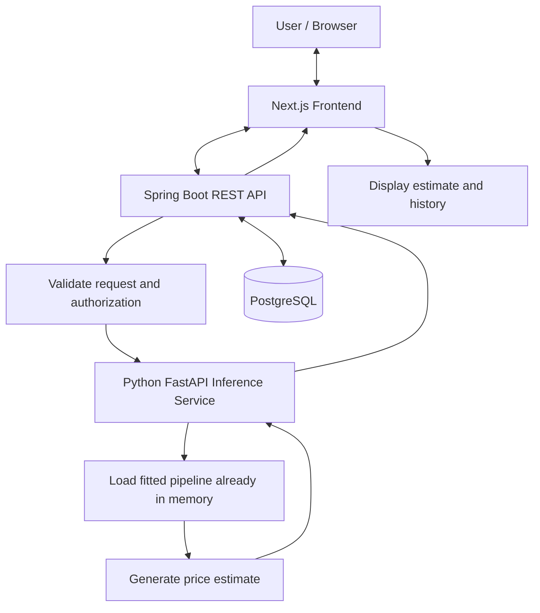
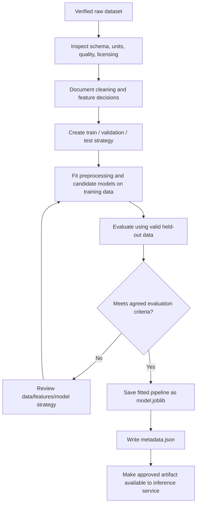

# System Architecture

**Status:** Target architecture; implementation pending.

## 1. Components and responsibilities

### Next.js frontend
- TypeScript, React, and Tailwind CSS
- Property input form, prediction result, user dashboard, prediction history, and admin screens
- Calls Spring Boot APIs
- Does not access PostgreSQL or call the internal inference service directly from the browser

### Spring Boot application backend
- Java 21, Spring Boot, Spring Data JPA/Hibernate
- Application REST API
- Registration, authentication, authorization, and role enforcement
- Property input validation and business rules
- Orchestrates prediction requests to FastAPI
- Persists users, property input snapshots, prediction results, and relevant metadata in PostgreSQL
- Applies schema changes through Flyway

### Python FastAPI inference service
- Loads the approved, versioned scikit-learn pipeline artifact
- Validates prediction input against the approved feature contract
- Performs inference and returns a structured response to Spring Boot
- Does not retrain the model per request
- Does not own application user accounts or prediction history

### Offline ML training
- Uses verified historical property data
- Performs data validation, exploratory analysis, preprocessing, splitting, training, and evaluation
- Saves the fitted preprocessing + estimator pipeline to a trusted `.joblib` artifact
- Produces metadata describing the model, data reference, dependency versions, and evaluation metrics
- Does not run as part of each online prediction request

### PostgreSQL
- Primary application data store
- Accessed primarily by Spring Boot
- Stores application records, not the binary model artifact in the initial design

## 2. Online prediction flow

Conceptual sequence:
1. The user submits property features through Next.js.
2. Spring Boot authenticates/authorizes the request and validates application-level input.
3. Spring Boot sends the approved feature contract to the internal FastAPI service.
4. FastAPI validates input and uses the loaded fitted pipeline to predict.
5. FastAPI returns a structured estimate and model/version information where defined by the final contract.
6. Spring Boot persists the prediction and relevant input snapshot in PostgreSQL.
7. Spring Boot returns the result to Next.js, which displays it.

Error handling must cover invalid input, unsupported features/locations, unavailable ML service, missing or incompatible artifact, and database failures. Do not expose internal stack traces.

## 3. Offline training and artifact flow

The exact feature schema, split strategy, acceptance thresholds, and candidate models must be decided after inspecting the dataset. Do not tune against the final held-out test set.

## 4. Data ownership and security
- Spring Boot is the primary database owner.
- FastAPI should be an internal service, not directly exposed as a public browser API.
- All secrets and environment-specific configuration are externalized.
- Model artifacts must come from trusted build/training outputs.
- The model produces estimates, not guaranteed market valuations.

## 5. Dataset status
Candidates discussed:
- Pune House Price dataset: https://github.com/Sahil9822/Pune-House-Price-Prediction
- Possible CSV candidate: https://raw.githubusercontent.com/prashantmane92/dataset/main/Pune_House_Data.csv
- Secondary candidate: https://www.kaggle.com/competitions/indian-urban-house-price-prediction/data

These are not yet verified or approved. Inspect source, license, columns, target meaning, currency, units, dates, coverage, and quality before training or combining.

## 6. Deployment boundary
Local development is intended to run without Docker. Docker is reserved for the later production/deployment phase. Hosting provider and production topology remain undecided.
